# Gobi MVP: Operational Shipment Coordination Platform

An operational coordination workspace for logistics companies managing domestic and cross-border freight, built as a university capstone project.

Gobi is **not** a courier app, ride-hailing platform or trucking marketplace. It is the system coordinators use to run shipments: one lifecycle, one structured event timeline, one document checklist, compliance gates before dispatch, a payments ledger and a full audit trail. It replaces the WhatsApp messages, phone calls and spreadsheets that coordinate freight today.

> **Design principle: manual first, integration ready.** Coordinators record operational events by hand today. Future GPS, customs or payment integrations write the *same* structured events automatically, so the workflow never changes.

- **Repository:** https://github.com/uwambajeddy/gobi-mvp
- **Live app:** https://gobi-mvp.netlify.app (API: https://gobi-api-production.up.railway.app/api/v1/docs)
- **Walkthrough video:** https://youtu.be/hnVzYC8zbrU
- **Technical report (PDF):** [docs/Gobi-Technical-Report.pdf](docs/Gobi-Technical-Report.pdf)
- **Track:** FullStack (Next.js frontend, Express + PostgreSQL backend)

## Architecture

```
gobi-mvp/
├── api/                      Express 4 + Sequelize 6 + PostgreSQL REST API
│   ├── src/
│   │   ├── config/           Lifecycle, event and document-checklist definitions
│   │   ├── controllers/      HTTP handlers, one per resource (thin: validate, call services, respond)
│   │   ├── services/         Business rules: document and compliance gates, access policies, events, email, files
│   │   ├── middlewares/      JWT auth, organization context, RBAC and shipment policies, validation, uploads
│   │   ├── database/         Sequelize models (classes), migrations and seeders
│   │   ├── routers/api/v1/   Route definitions
│   │   ├── utils/            AppError, Logger, Socket.IO, notifications, Joi schemas
│   │   └── docs/             Swagger (OpenAPI) spec
│   └── tests/
│       ├── unit/             Pure gate logic (no database)
│       ├── api/              Integration tests over HTTP against a real test database
│       └── performance/      autocannon load test
├── web/                      Next.js 14 (App Router) + TypeScript + Tailwind operations workspace
│   ├── app/                  Routes: landing, auth, dashboard (shipments, fleet, organization, admin)
│   ├── components/           UI by feature (shipments, maps, layout, driver, ui primitives)
│   ├── hooks/ lib/ context/  Data hooks (React Query), API client, live tracking, acting-organization context
│   └── types/                Shared TypeScript types
├── docs/                     Screenshots, demo documents and testing evidence (docs/testing)
├── .github/workflows/ci.yml  API tests + web build on every push and pull request
└── docker-compose.yml        PostgreSQL 16 with dev + test databases
```

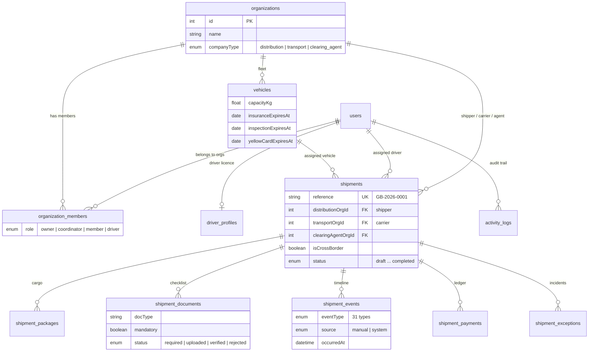

## The operational model

**Lifecycle** (condensed from the commercial 12-phase model; clearance, border and warehouse milestones live inside `in_transit` as events):

```
draft → submitted → quote_approved → awaiting_documents ⇄ documents_complete
      → execution_assigned → in_transit → arrived → delivered → completed
```

**Actors.** Every party works from the same shipment record:

| Actor | Representation | Responsibilities |
|---|---|---|
| Distribution company (shipper) | org `companyType=distribution` | Create shipments, upload commercial docs, approve quotes, confirm receipt |
| Transport company (carrier) | org `companyType=transport` | Quote, verify documents, assign vehicle+driver (gated), execute, record events, POD |
| Clearing agent | org `companyType=clearing_agent` | Customs milestones, clearance documents, duty payments |
| Coordinator | org member role `coordinator`/`owner` | The primary user, who orchestrates everything above |
| Driver | org member role `driver` + verified licence | Optional participant; coordinators can record events on their behalf |
| Receiver | plain fields + POD | Not a user; signs physically and is captured in the POD block |
| Platform admin | `users.type=admin` | Driver verification, org registry, audit trail, stats |

**The three control mechanisms:**

1. **Document Gate:** quote approval seeds a required-documents checklist (10 types; customs & corridor docs only for cross-border). Every mandatory document must be uploaded/verified and unexpired before dispatch. A rejection regresses `documents_complete` → `awaiting_documents`.
2. **Compliance Gate:** assignment is blocked on: unverified driver, expired licence, expired insurance/inspection, expired COMESA Yellow Card (cross-border), payload over vehicle capacity, or cargo above the 56,000 kg EAC GVW limit. Overrides require a written reason and are **permanently audited** with the exact failures at dispatch time.
3. **Closure rule:** completion requires POD captured and no open exceptions.

**Structured events:** 31 typed milestones (17 system-written, 14 manually recordable: pickup, checkpoints, border approached/cleared, customs submitted/released, warehouse arrived/released, arrival...). Each records who, when, where, notes and `source: manual|system`.

## Designs & screenshots

The interface is a role-aware operations workspace: a fixed sidebar whose navigation changes with the acting organization (shipper, carrier, clearing agent, driver or platform admin), an "Acting as" organization switcher, and a single shipment workspace with tabs for the timeline, documents, assignment, payments and exceptions. The data model is the ER diagram above; the screens below are captured from the running app with the seeded demo data.

| | |
|---|---|
|  **Landing page** | 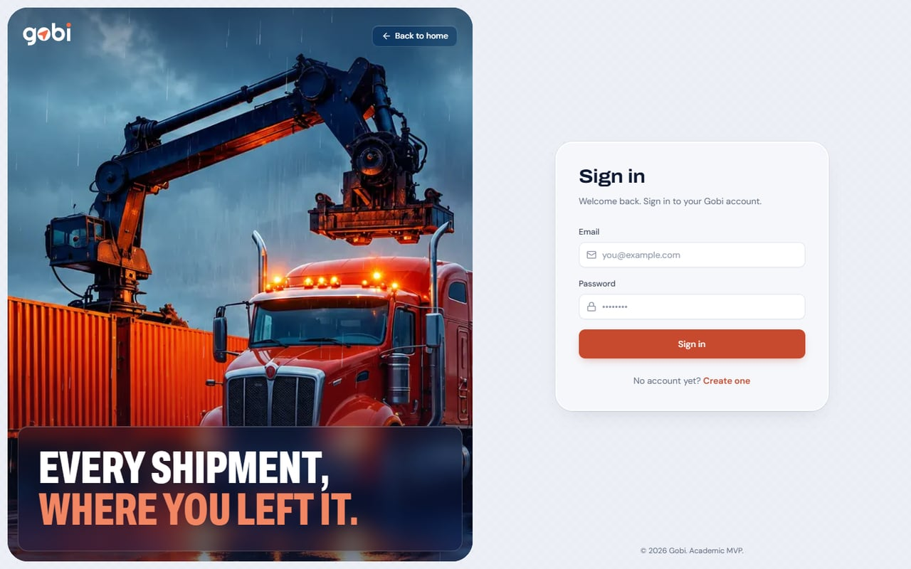 **Sign in** (NextAuth credentials) |
| 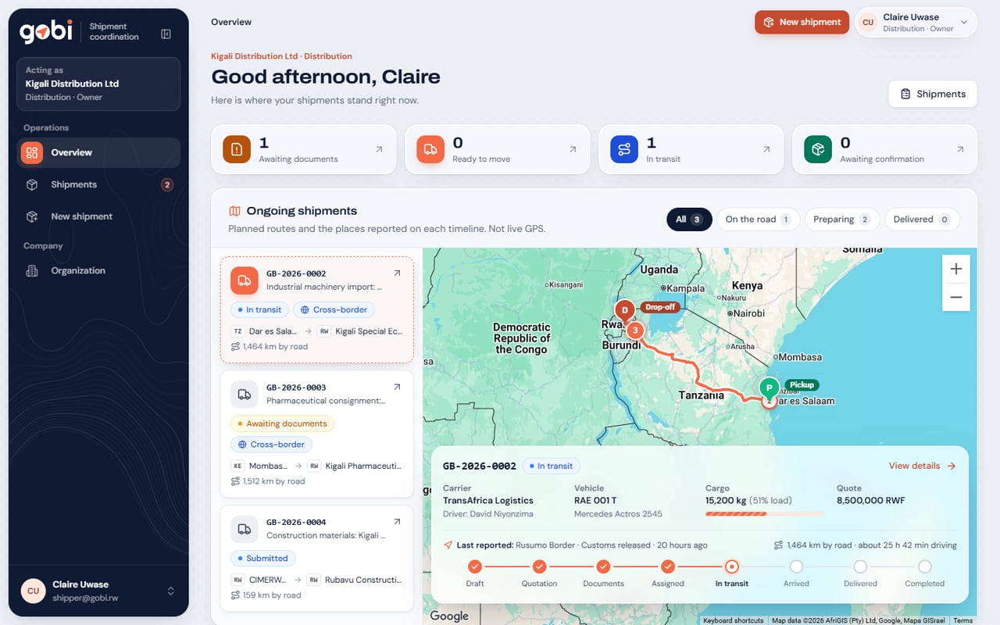 **Shipper overview:** status counters and a map of ongoing shipments with their routes and reported milestones | 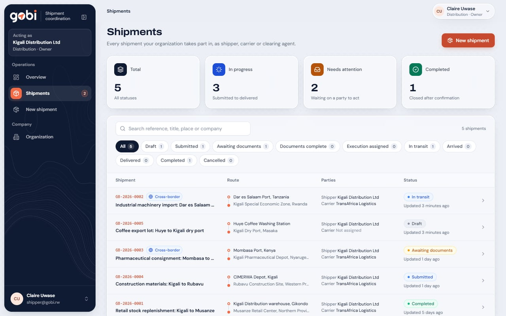 **Shipments list:** search and filter by lifecycle status |
| 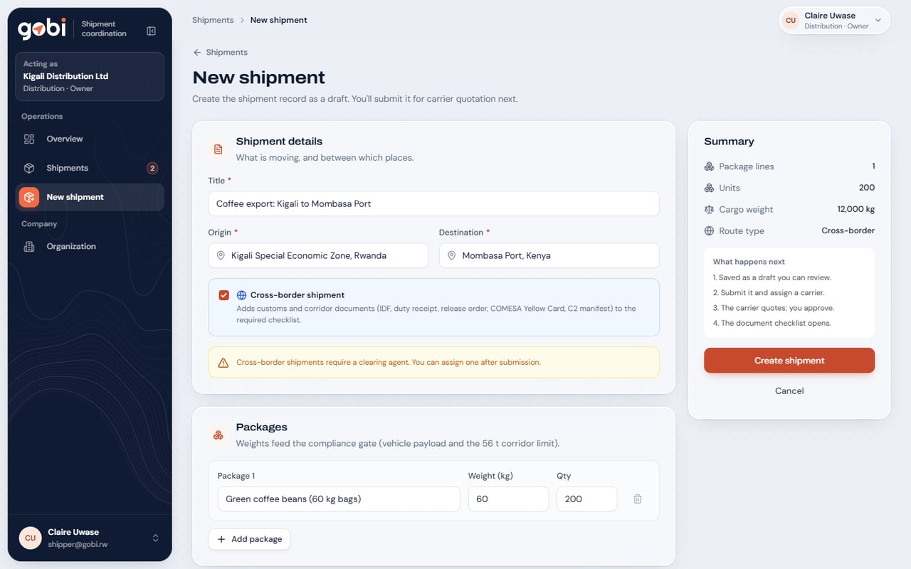 **New shipment:** cross-border toggle extends the document checklist | 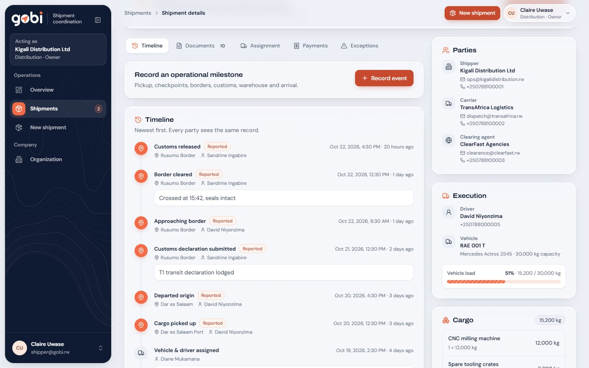 **Structured timeline:** manual and system events on the corridor |
| 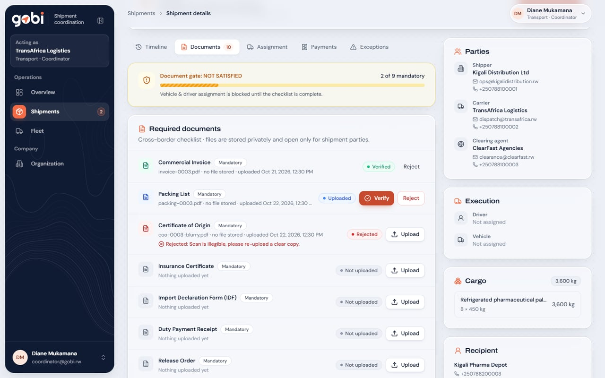 **Document Gate:** assignment blocked until every mandatory document is in place | 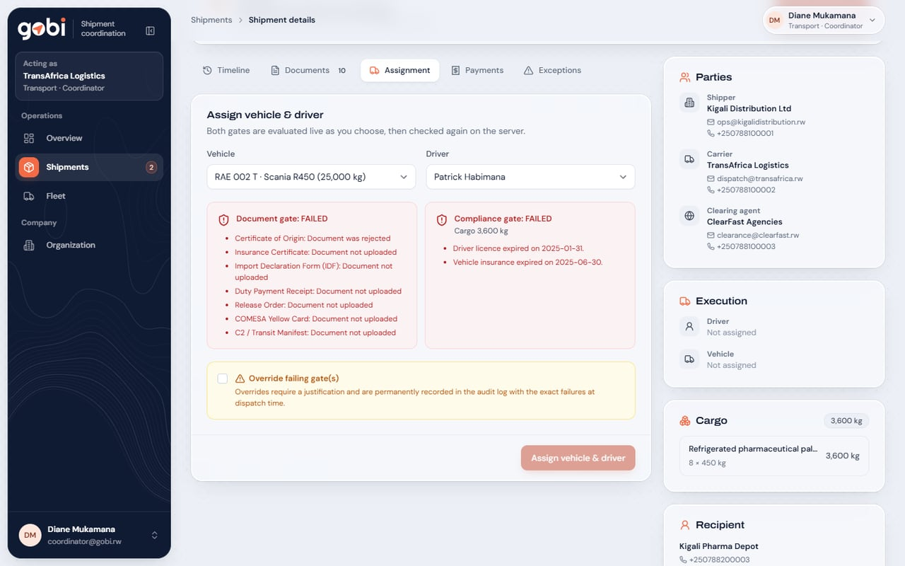 **Compliance Gate:** live preview blocks an expired-insurance truck and an expired-licence driver; overriding needs a written reason |
| 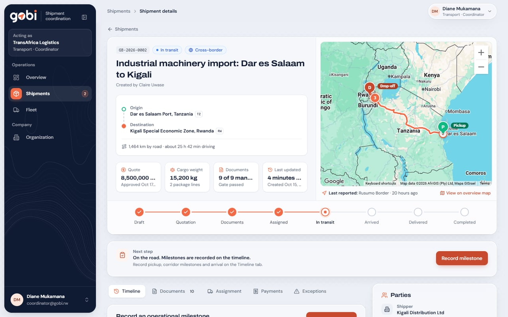 **Shipment workspace:** route map, key facts and lifecycle progress | 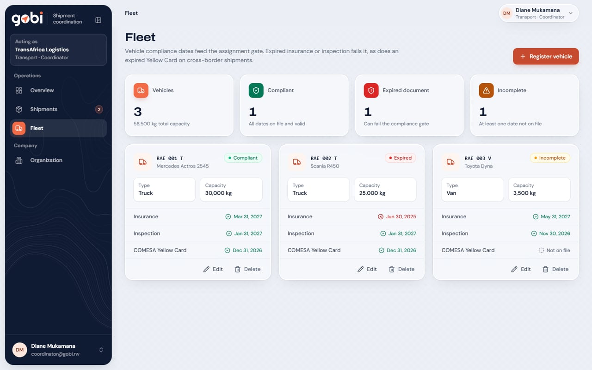 **Fleet:** insurance, inspection and Yellow Card expiry feed the Compliance Gate |
| 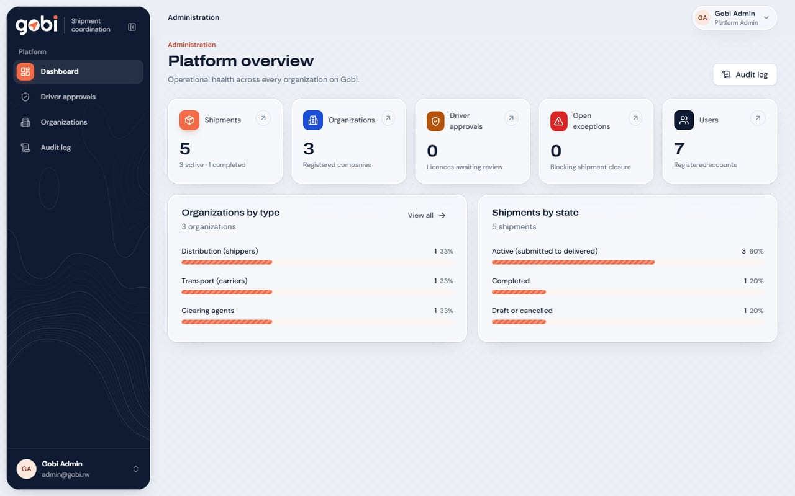 **Platform admin dashboard** | 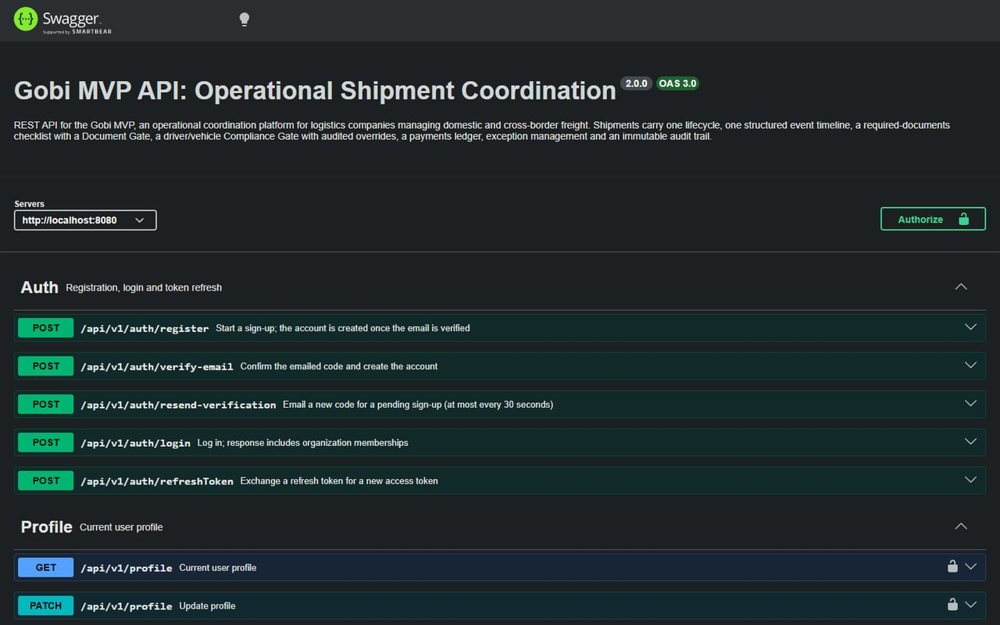 **Swagger UI** for the REST API |

## Technical requirements

| Requirement | Version | Notes |
|---|---|---|
| Node.js | 18 or later (developed on 24, CI on 20) | API and web |
| npm | 9 or later | |
| PostgreSQL | 16 | Provided by Docker Compose on port 5433 |
| Docker Desktop | any recent | Only for the local database |
| Browser | Chrome, Edge, Firefox or Safari (current) | Location sharing needs `localhost` or HTTPS |

| Layer | Main frameworks and SDKs |
|---|---|
| API | Express 4.18, Sequelize 6.23 (`pg` 8), jsonwebtoken 8, bcryptjs, Joi 17, Socket.IO 4.8, Cloudinary SDK 2, Brevo (REST), Swagger UI |
| Web | Next.js 14.2, React 18, TypeScript 5.9, Tailwind CSS 3.4, NextAuth 4.24, TanStack React Query 5, socket.io-client 4.8, `@vis.gl/react-google-maps` |
| Tests | Mocha 10, Chai 4, chai-http, nyc, autocannon 7 |

Optional external services: Cloudinary (document files), Brevo (email) and a Google Maps JavaScript API key (route maps). The app runs without them; uploads, emails and maps are then unavailable.

## Getting started

Prerequisites: see [Technical requirements](#technical-requirements).

```bash
# 1. Database: creates gobi_mvp_dev + gobi_mvp_test on localhost:5433
docker compose up -d

# 2. API
cd api
npm install
cp .env.example .env    # add Cloudinary keys for document files and Brevo keys for email
cp .env.test.example .env.test
npm run aio          # migrate + seed + start on http://localhost:8080

# 3. Web (new terminal)
cd web
npm install
cp .env.example .env.local   # optional: set NEXT_PUBLIC_GOOGLE_MAPS_API_KEY for route maps
npm run dev          # http://localhost:3000

# 4. Tests
cd api
npm run test:ci      # prepares the test DB then runs the Mocha suite
```

Swagger documentation: http://localhost:8080/api/v1/docs

## Seeded demo accounts

All passwords: `Password123!`

| Email | Persona |
|---|---|
| admin@gobi.rw | Platform admin (driver approvals, audit log, stats) |
| shipper@gobi.rw | Owner, **Kigali Distribution** (shipper) |
| carrier@gobi.rw | Owner, **TransAfrica Logistics** (carrier) |
| coordinator@gobi.rw | Coordinator at TransAfrica (the primary user) |
| driver@gobi.rw | Driver, licence valid ✅ |
| driver2@gobi.rw | Driver, licence **expired** ⛔ (compliance-gate demo) |
| agent@gobi.rw | Owner, **ClearFast Agencies** (clearing agent) |

Seeded fleet: `RAE 001 T` fully compliant · `RAE 002 T` insurance **expired** ⛔ · `RAE 003 V` van without a Yellow Card.

Seeded shipments: `GB-2026-0001` completed (full history) · `GB-2026-0002` cross-border **in transit** mid-corridor · `GB-2026-0003` awaiting documents (one rejected) · `GB-2026-0004` submitted with quote · `GB-2026-0005` draft.

## Document files and email

**Document files (Cloudinary).** Uploads accept PDF, JPG or PNG up to 10 MB; the type is checked from the file's content, not its name. Files are stored as private Cloudinary assets. To view one, the web app asks `GET /shipments/documents/:docId/file`, which checks that the caller is a party to the shipment and returns a download link that expires after 5 minutes. Seeded documents carry a file name only and show "no file stored".

**Email (Brevo).** The API emails whoever has to act next: carrier and clearing-agent assignment, quote received, quote approved, document rejected (to the uploader), documents complete, vehicle and driver assigned (to the driver and the shipper), cargo picked up and arrived at destination (to the shipper), exception opened, proof of delivery, completion and cancellation, plus a welcome email, "added to an organization" and driver-licence review results. Emails are sent in the background, never block the action, and never go to the person who acted.

The seeded `@gobi.rw` addresses cannot receive mail, so for development and demos set `EMAIL_REDIRECT_TO` to one inbox: every email goes there, with the intended recipient shown in the subject. Tests never send email or touch Cloudinary.

## Live driver tracking (Socket.IO)

From the moment the driver taps **Going to pickup** until they tap **Arrived at destination**, the assigned driver's browser shares its GPS position and every party sees the truck move on the shipment map and on the dashboard's ongoing-shipments map. Same design as the commercial platform:

1. **Driver** (`hooks/useDriverBackgroundTracker.ts`, mounted in the dashboard shell): `navigator.geolocation.watchPosition`, throttled to one fix per 10 s and 20 m of movement (or every 2 min when parked). Each fix goes out twice: the `newCoordinates` socket event (live, best-effort) and `PATCH /api/v1/shipments/:id/location` (saved, with the last 100 points kept in `trackings`). A chip in the top bar shows whether the location is being shared (amber or red when paused or blocked) and lets the driver pause it; the driver's trip card says the same, with the fix, when the shipper can't see the truck.
2. **API** (`utils/socket.io.js`): sockets authenticate with the access token (`protectSocket`). On `newCoordinates` the API checks the `updateLocation` policy (assigned driver, trip started and not yet arrived), saves `currentLocation`, and emits `newCoordinates` to the staff of the shipper, carrier and clearing agent plus the driver.
3. **Viewers** (`hooks/useShipmentLiveLocation.ts`): the shipment map listens for `newCoordinates`, and polls `GET /api/v1/shipments/:id/tracking` as a safety net (every 30 s, or 8 s while the socket is down). The status line shows *Live* or *Polling* and flags a position older than 2.5 minutes as possibly outdated.

To demo it, sign in as `driver@gobi.rw` in one browser and `shipper@gobi.rw` in another, and open a shipment with the driver assigned (walkthrough step 4) to start from *Going to pickup*, or `GB-2026-0002` (seeded in transit). Allow location for the driver, then move the truck with Chrome DevTools → **Sensors** → *Location*. Browsers only share GPS with `localhost` or HTTPS pages, so a phone needs the web app served over HTTPS.

## Driver progress and notifications

The driver updates the shipment with one button per step on the **Your trip** card (`components/shipments/DriverProgress.tsx`); the other parties see the same steps read-only as **Driver progress**. Same flow as the commercial driver app (*Start delivery → Mark picked up → Submit POD*):

| Button | Records | Status | Also |
|---|---|---|---|
| Start trip to pickup | `en_route_to_pickup` | stays *execution assigned* | stamps `startTime`; live tracking starts |
| Arrived at pickup | `arrived_pickup` | stays *execution assigned* | |
| Cargo loaded, start transit | `picked_up` | → *in transit* | email to the shipper |
| Arrived at destination | `arrived_destination` | → *arrived* | live tracking stops; email to the shipper |
| Confirm delivery | proof of delivery (`POST /pod`) | → *delivered* | the shipper then confirms receipt → *completed* |

The four steps go through `POST /shipments/:id/events` and are defined once in `config/shipmentEvents.js` (`DRIVER_MILESTONES`): only the assigned driver or the carrier's coordinators may record them, in the right status, and each only once, so a double tap is refused.

Every step, plus vehicle-and-driver assignment and completion, notifies the parties the way the commercial platform's `notifyDeliveryStatusChange` does (`utils/shipmentStatusNotifications.js`):

1. **In-app notification** for the shipper's, carrier's and clearing agent's staff and the driver, never the person who acted. `createNotification` (`utils/notification.js`) stores it in `notifications` and pushes it live as the `newNotification` socket event; the bell in the top bar lists the latest 20 (`GET /notifications`).
2. **`shipmentStatusUpdate` socket event** to every party (the commercial `deliveryStatusUpdate`): open screens show a toast and refresh the shipment, its timeline, lists and maps (`components/layout/ShipmentStatusListener.tsx`).
3. **Email** where a rule exists in `services/notifications.service.js`.

## Demo walkthrough

1. **Shipper** (`shipper@gobi.rw`): create a cross-border shipment with packages → submit → assign TransAfrica as carrier and ClearFast as clearing agent.
2. **Coordinator** (`coordinator@gobi.rw`): submit a quote. **Shipper**: approve it and the document checklist appears.
3. Upload the mandatory documents as PDF or image files (any party); the **coordinator** opens each one with **View** and verifies it from the viewer. Watch the Document Gate flip to green and the status advance to *Documents complete*. Reject one to see it regress (the uploader gets an email with the reason).
4. **Coordinator** → Assignment tab: pick the expired-insurance truck + expired-licence driver and the Compliance Gate **blocks** with exact failures. Either fix the pairing (RAE 001 T + driver@) or override with a written reason (audited).
5. **Driver** (`driver@gobi.rw`): open the assignment and tap through **Your trip**: *Start trip to pickup* (the shipper's map starts showing the truck live), *Arrived at pickup*, *Cargo loaded, start transit* (status → in transit). Each tap pops a toast and a bell notification for the shipper and carrier. Log the corridor on the Timeline as it happens: *border approached*, *border cleared* ("Truck crossed Rusumo at 15:42"), *customs released*. Then tap *Arrived at destination*.
6. **Driver**: *Confirm delivery* with the receiver's name → shipper confirms receipt → *completed*. Try completing with an open exception first to see the closure rule.
7. **Admin** (`admin@gobi.rw`): review the audit log. Every action above is there with actor, role, organization and the gate-override evidence.

## API overview

Base URL: `http://localhost:8080/api/v1`. Full spec at `/api/v1/docs`.

| Area | Endpoints |
|---|---|
| Auth | `POST /auth/register`, `POST /auth/login`, `POST /auth/refreshToken` |
| Organizations | `POST/GET /organizations`, `GET /organizations/mine`, `GET/POST /organizations/:id/members` |
| Shipment lifecycle | `POST/GET /shipments`, `GET/PATCH /shipments/:id`, `POST /shipments/:id/submit\|cancel` |
| Award | `POST /shipments/:id/assign-carrier\|assign-clearing-agent\|quote\|approve-quote` |
| Documents | `GET/POST /shipments/:id/documents` (multipart upload), `GET /shipments/documents/:docId/file` (signed view link), `PATCH /shipments/documents/:docId/verify\|reject` |
| Assignment | `GET /shipments/:id/assignment-preview`, `POST /shipments/:id/assign` (gates + audited override) |
| Timeline | `GET/POST /shipments/:id/events` (including the driver's progress steps) |
| Live tracking | `GET /shipments/:id/tracking`, `PATCH /shipments/:id/location` (assigned driver, from going to pickup until arrival), Socket.IO event `newCoordinates` |
| Notifications | `GET /notifications`, `PATCH /notifications/read`, `PATCH /notifications/read/:id`, Socket.IO events `newNotification` and `shipmentStatusUpdate` |
| POD & closure | `POST /shipments/:id/pod`, `POST /shipments/:id/complete` |
| Payments | `GET/POST /shipments/:id/payments`, `PATCH /shipments/payments/:id/mark-paid` |
| Exceptions | `GET/POST /shipments/:id/exceptions`, `PATCH /shipments/exceptions/:id/resolve` |
| Fleet | `GET/POST/PATCH/DELETE /vehicles` |
| Driver | `GET/POST /driver/profile` |
| Admin | `GET/PATCH /admin/drivers`, `GET /admin/organizations`, `GET /admin/activity-logs`, `GET /admin/stats` |

Multi-org users select their acting organization with the `x-organization-id` header (set automatically by the web app's org switcher).

## Tech stack

**Backend:** Express 4, Sequelize 6 (PostgreSQL), JWT auth with organization-scoped RBAC, Joi validation, service-layer gates (document / compliance), immutable `activity_logs`, Cloudinary (private document storage, multer uploads), Brevo (transactional email), Socket.IO (live driver tracking), Swagger UI, Babel, Mocha + Chai + chai-http + nyc.

**Frontend:** Next.js 14 App Router, TypeScript, Tailwind CSS, NextAuth (credentials), TanStack React Query, React Hook Form + Zod, Axios with org-context header, socket.io-client, Lucide icons.

**Tooling:** Docker Compose (PostgreSQL 16 with separate dev and test databases), sequelize-cli migrations and seeders, nodemon, GitHub Actions CI, Git + GitHub with feature branches merged into `main`.

## Testing

```bash
cd api
npm run test:ci     # resets gobi_mvp_test (migrate + seed), then runs every test with nyc coverage
npm run test:unit   # unit tests only; no database needed
API_URL=https://gobi-api-production.up.railway.app npm run test:load   # load test (defaults to localhost)
```

| Strategy | What it covers | Result |
|---|---|---|
| Unit (`tests/unit`) | The Document and Compliance Gate rules in isolation: expiry boundaries (expires today passes, yesterday fails), capacity and 56 t GVW limits, cross-border-only Yellow Card, warnings vs. blocking failures | 17 passing |
| Integration (`tests/api`) | Every endpoint over HTTP against a real PostgreSQL database: auth, organizations and RBAC, the shipment lifecycle, gates with audited overrides, events, payments, exceptions, POD and closure, files, notifications, live tracking, admin, and authorization (who may and may not act) | 137 passing |
| Performance | autocannon against the deployed API (10 connections × 10 s per scenario) | Reads: p50 204–231 ms, 40–45 req/s, 0 errors. Login (bcrypt): p50 604 ms. [Results](docs/testing/load-test-production.txt) |
| Compatibility (`cd web && npm run test:compat`) | Playwright walkthrough of the deployed app (sign in, shipments list, cross-border shipment, Google route, timeline and documents tabs) on Chrome 156, Edge 156, Firefox 132, WebKit 18.2, and emulated Pixel 7 and iPhone 14; plus a manual pass in desktop Chrome | All pass, 0 console errors, no sideways scrolling. Found and fixed a mobile layout bug (shipment summary clipped on phones). [Results and screenshots](docs/testing/compatibility) |
| Front-end quality | Lighthouse on the deployed web app, mobile and desktop profiles | Desktop: performance 90, accessibility 96, best practices 100, SEO 100. Mobile: 62 / 96 / 100 / 100. [Desktop](docs/testing/lighthouse-desktop.html) · [mobile](docs/testing/lighthouse-mobile.html) |

Current result: **154 passing, 0 failing**, with 87.8% statement and 88.4% line coverage ([summary](docs/testing/coverage-summary.txt)). CI ([`.github/workflows/ci.yml`](.github/workflows/ci.yml)) runs the full suite against a PostgreSQL 16 service container and the web production build (which type-checks) on every push to `main` and every pull request.

## Deployment plan

The demo environment runs on two managed services:

| Component | Platform | URL |
|---|---|---|
| Web (`web/`) | Netlify (Next.js runtime) | https://gobi-mvp.netlify.app |
| API (`api/`) + PostgreSQL | Railway, project `gobi-mvp` (services `gobi-api` and `Postgres`) | https://gobi-api-production.up.railway.app |

| Component | Build / start | Configuration |
|---|---|---|
| PostgreSQL | Railway Postgres, private network only | The API reads `DATABASE_URL=${{Postgres.DATABASE_URL}}`; SSL is required by the `production` Sequelize config |
| API | `npm run build` / `npm run start:prod` (runs pending migrations, then starts) | `NODE_ENV=production`, `RAILPACK_START_CMD=npm run start:prod`, `NPM_CONFIG_INCLUDE=dev` (Babel and sequelize-cli are devDependencies), `DATABASE_URL`, `JWT_ACCESS_SECRET`, `JWT_REFRESH_SECRET`, `JWT_ACCESS_TIME`, `JWT_REFRESH_TIME`, `CLOUDINARY_CLOUD_NAME`, `CLOUDINARY_API_KEY`, `CLOUDINARY_API_SECRET`, `BREVO_API_KEY`, `BREVO_SENDER_EMAIL`, `BREVO_SENDER_NAME`, `WEB_APP_URL` and `EMAIL_ASSET_URL` (web URL). The demo sets `EMAIL_REDIRECT_TO` because the seeded `@gobi.rw` accounts aren't real inboxes; never set it with real users. |
| Web | `npm run build` (`web/netlify.toml`) | `NEXT_PUBLIC_API_URL` (API URL), `NEXTAUTH_URL` (web URL), `NEXTAUTH_SECRET`, `NEXT_PUBLIC_GOOGLE_MAPS_API_KEY`, optional `NEXT_PUBLIC_GOOGLE_MAPS_MAP_ID` |

**Release steps**

1. API: from `api/`, `railway up --service gobi-api --ci`. Migrations run on start; `.railwayignore` keeps local `.env` files out of the upload.
2. Web: automatic. The Netlify site builds `web/` from `main` on every push (base directory `web`, settings in `web/netlify.toml`, which declares the Next.js runtime).
3. Seed (`npx sequelize-cli db:seed:all`) only once, on a demo environment, never on real data. The demo database is already seeded.
4. For maps, allow the web domain in the Google Maps key's HTTP-referrer restrictions (Maps JavaScript, Places (New) and Routes APIs), and use a production Map ID (`NEXT_PUBLIC_GOOGLE_MAPS_MAP_ID`; the default `DEMO_MAP_ID` is for development only).
5. Smoke test: open `/api/v1/docs`, sign in as each persona and run the demo walkthrough above.

**Before real users**

- Restrict CORS on the API to the web app's origin (it is open for local development).
- Payment proofs still record a file name only; move them to the same private Cloudinary storage as documents.
- Generate long random JWT and NextAuth secrets per environment, and enable automated database backups.
- Remove or re-password the seeded demo accounts: their password is published in this repository.

## License

ISC (academic project).
